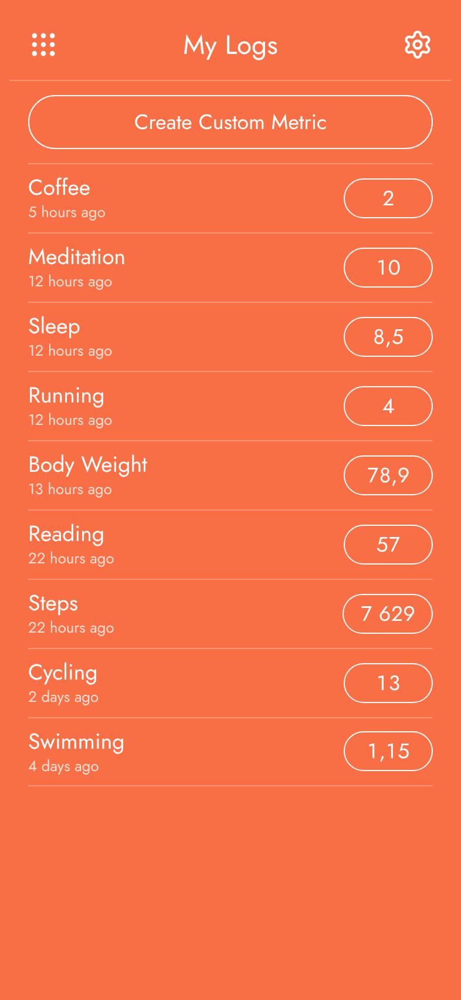
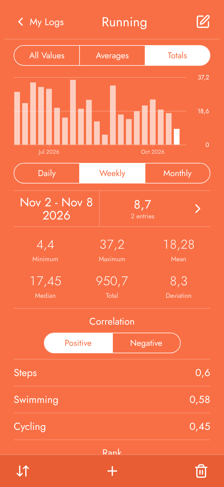
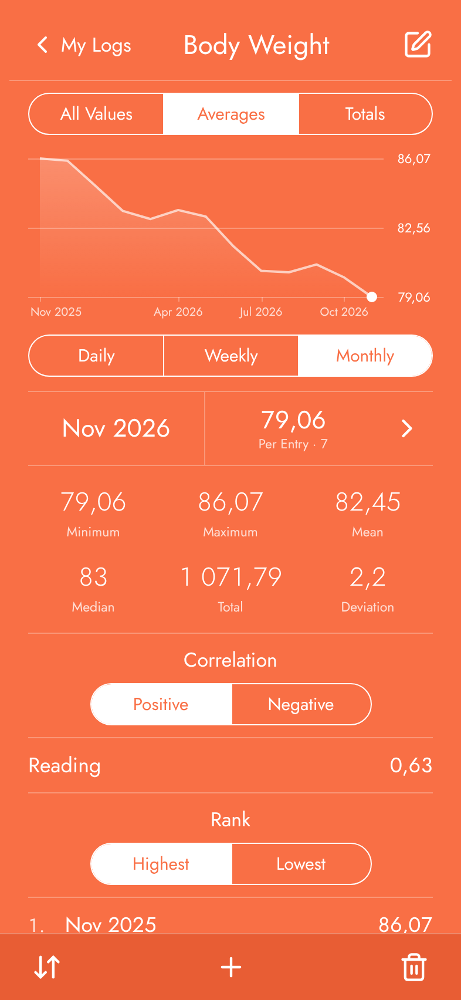

<p align="center"></p>

<h1 align="center">Lokki</h1>

<p align="center">
  <picture><source media="(prefers-color-scheme: dark)" srcset="docs/screenshots/home-dark.png"></picture>
  <picture><source media="(prefers-color-scheme: dark)" srcset="docs/screenshots/running-dark.png"></picture>
  <picture><source media="(prefers-color-scheme: dark)" srcset="docs/screenshots/weight-dark.png"></picture>
</p>

A personal life-logging app: log values (a swim, your weight, anything you count) and see them as totals and
averages per day, week or month, with rankings, distributions, correlations and day-of-week patterns.

Lokki is a web app that keeps its data on your device (IndexedDB) and can sync it between devices. It is the
successor to _Loggr – Graph Your Life_, an iOS app that is no longer available. It imports that app's CSV exports,
its own, and ordinary spreadsheets (.xlsx, .ods or CSV, with a date column and a column of numbers per metric),
showing what it found before adding anything.

## Status

Lokki runs at <https://lokki.jocke.fi>. It keeps everything on your device, and can sync between devices through one
or more sync servers you choose: end-to-end encrypted with a passphrase, so servers can't read your logs. Set it up
in Preferences → Sync with a server's URL and a token from its operator. To run a server yourself, see
[servers/python](servers/python/README.md).

On an iPhone, open the site in Safari and choose Share → Add to Home Screen. It works offline once opened.

To look around first, open <https://lokki.jocke.fi/?demo>: a year of made-up logs, ending now, reset every time you open it.
The demo keeps its data apart from yours, never syncs, and is wiped when you close it.

## Layout

```
index.html          the page; loads src/app.js as an ES module (no build step needed)
public/             static files: styles, the Jost font, icons, web app manifest
src/core/           pure functions: formatting, periods, statistics, ids, CSV and tables, zip, backup format
src/data/           this device's copy: state, IndexedDB, local changes, backups
src/sync/           syncing: encryption, merge rules and the sync engine for Lokki servers
src/ui/             rendering, sheets, chart, entry list, preferences, files
scripts/            dev server, the site build (with its service worker), screenshots
tests/unit/         node:test unit tests
tests/e2e/          Playwright tests: simulated devices running the built site and the unbundled modules
docs/               the sync protocol
protocol/           the protocol's test vectors, conformance tests and Python reference implementation
servers/python/     the sync server: FastAPI, SQLAlchemy (see its README)
```

## Sync

The sync protocol (end-to-end encrypted, any number of servers) is described in
[docs/sync-protocol.md](docs/sync-protocol.md).

## Development

Requirements: Node.js 22+ and [pre-commit](https://pre-commit.com).

```sh
npm ci
pre-commit install --install-hooks   # checks on every commit, unit tests before every push
npm run serve                        # http://localhost:8080
npm test                             # unit tests
npm run test:sync                    # the sync engine against the Python server (needs uv)
npx playwright install chromium      # once, for the end-to-end tests
npm run test:e2e                     # builds the site, then runs the end-to-end tests
npm run icons                        # regenerate src/ui/lucide.js after changing the icon list or Lucide version
npm run screenshots                  # regenerate docs/screenshots (the demo, light and dark) after a visual change
npm run build:site                   # dist/site, the site deployed to GitHub Pages
```

Every push to `main` deploys the site to GitHub Pages (`.github/workflows/pages.yml`).

The end-to-end tests run against both the built site and the unbundled modules, with generated data only.

## License

[MIT](LICENSE). Third-party material is listed in [THIRD_PARTY_NOTICES.md](THIRD_PARTY_NOTICES.md).
